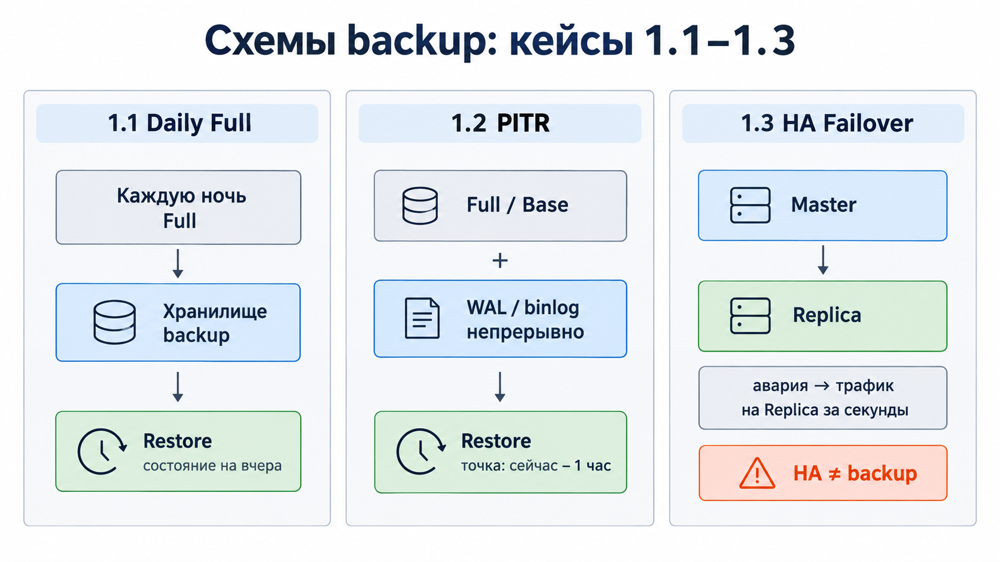
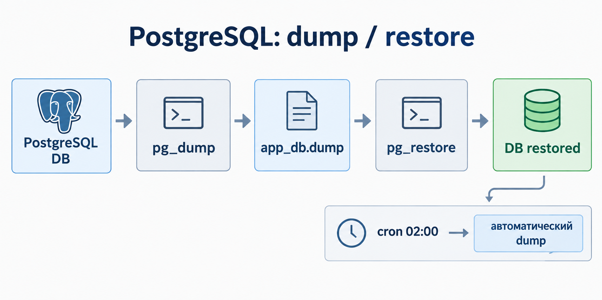
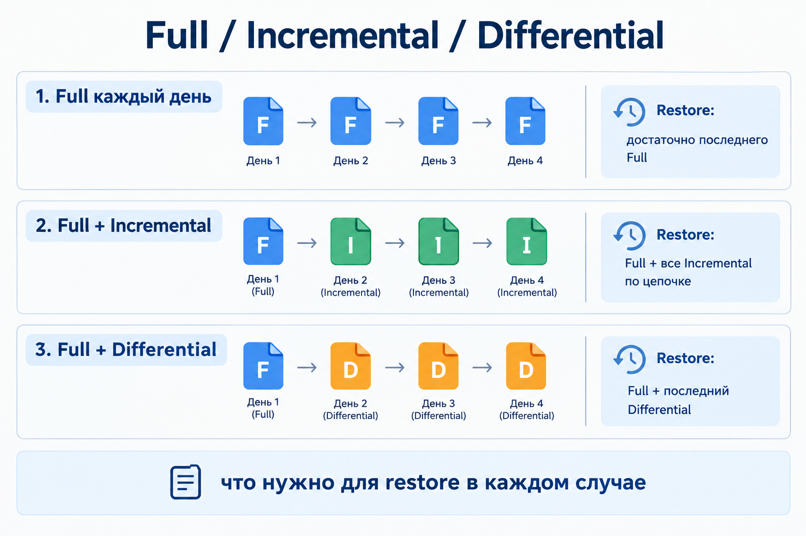
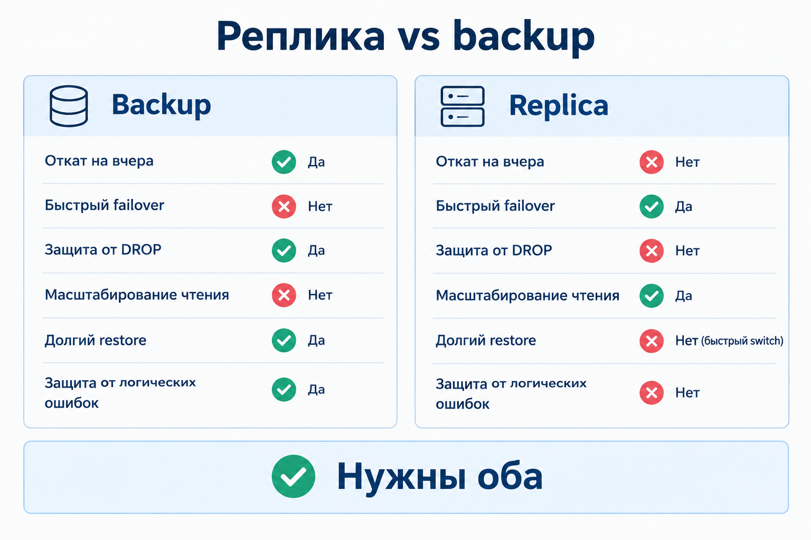

# 12.8. Резервное копирование баз данных — Денис Силюков

Решение ДЗ: [12.8. Резервное копирование баз данных — Денис Силюков.md](./12.8.%20Резервное%20копирование%20баз%20данных%20—%20Денис%20Силюков.md)

---

## Задание 1

### 1.1. Ежедневный Full backup

Нужен ежедневный **Full backup** (логический или физический). **RPO ≈ сутки**.

| СУБД | Логический | Физический |
|---|---|---|
| PostgreSQL | `pg_dump` | `pg_basebackup` |
| MySQL | `mysqldump` | XtraBackup / snapshot |

Бэкапы хранить **не на том же диске/сервере**. Обязательно проверять **restore**.

### 1.2. Point-in-Time Recovery (PITR)

Нужен PITR: регулярный **base/full** + журналы (**PostgreSQL WAL**, **MySQL binlog**).

Restore: восстановить base → проиграть логи до момента «час до поломки».

### 1.3.* Высокая доступность vs backup

Да — через **HA/failover** на replica/кластер. Это **не замена backup**: логическая порча (DROP/DELETE) улетит на реплики. Нужны и HA, и отдельные бэкапы.



---

## Задание 2. PostgreSQL

### 2.1. Dump / restore

```bash
pg_dump -U postgres -Fc -f /backups/app_db.dump app_db
createdb -U postgres app_db_restored
pg_restore -U postgres -d app_db_restored /backups/app_db.dump
```

Документация:

- [pg_dump](https://www.postgresql.org/docs/current/app-pgdump.html)
- [pg_restore](https://www.postgresql.org/docs/current/app-pgrestore.html)

### 2.1.* Автоматизация

- `cron` / `systemd timer` + скрипт с проверкой ошибок, ротацией и alert;
- или готовые решения: **pgBackRest** / **Barman**;
- в Kubernetes — **CronJob**.



---

## Задание 3. MySQL

### 3.1. Incremental backup

`mysqldump` **не инкрементальный**. Для incremental — **Percona XtraBackup** (или MySQL Enterprise Backup):

```bash
xtrabackup --backup --target-dir=/backups/full
xtrabackup --backup --target-dir=/backups/inc1 --incremental-basedir=/backups/full
```

Для PITR дополнительно нужны **binlog**.

Типы цепочек (Full / Incremental / Differential):



### 3.1.* Когда реплика лучше backup

Реплика лучше, когда нужны:

- быстрый failover (низкий RTO);
- разгрузка SELECT;
- снятие backup со slave.

Реплика **не** даёт откат «на вчера» и **не** защищает от DROP/DELETE. Нужны оба подхода.


